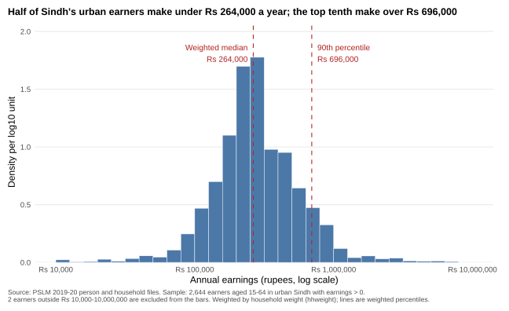
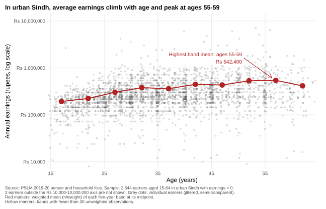
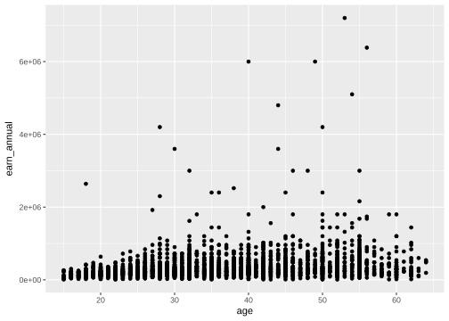
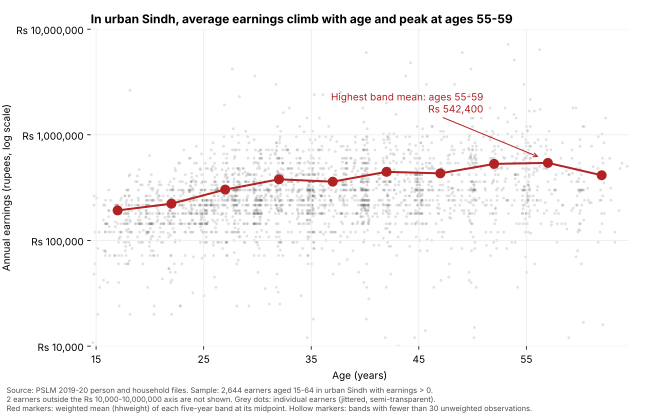

# ECO346 Assignment 1 - FA24-BEDS-075

**Variant 3: Sindh, urban.** Registration number 075 = 9 x 8 + 3, so the remainder is 3. Sample: persons aged 15-64 with `earn_annual` > 0 in Sindh urban areas (`prov_code` == 3, `urban_rural` == 2): **2,644 earners**. Everything is weighted by `hhweight`.

## How to reproduce
From the repository root (no internet needed; the data are in `data/`):

```
Rscript scripts/01_default.R
Rscript scripts/02_histogram.R
Rscript scripts/03_scatter.R
python scripts/04_scatter_python.py
```

R packages: `ggplot2`, `scales`, `svglite`. Python packages: `pandas`, `numpy`, `matplotlib`. Script 04 checks its band table against the one written by script 03.

## Question 2 - the distribution


| Statistic | Value |
|---|---|
| Earners | 2,644 |
| Weighted median | Rs 264,000 |
| Unweighted median | Rs 252,000 |
| Weighted 10th percentile | Rs 120,000 |
| Weighted 90th percentile | Rs 696,000 |
| 90th / 10th ratio | 5.80 |
| Excluded (outside Rs 10,000-10,000,000) | 2 |

Urban Sindh earnings are roughly bell-shaped on the log scale, centred near Rs 250,000, with a long right tail: the 90th percentile (Rs 696,000) is 5.80 times the 10th (Rs 120,000). The weighted median (Rs 264,000) exceeds the unweighted (Rs 252,000) because higher earners tend to carry larger household weights: weighted, only 46.5% earn Rs 252,000 or less, against 50.3% unweighted. The sample therefore over-represents lower earners relative to the population.

## Question 3 - the relationship


| Age band | Earners | Weighted mean earnings (Rs) |
|---|---|---|
| 15-19 | 160 | 192,523 |
| 20-24 | 296 | 222,948 |
| 25-29 | 398 | 303,154 |
| 30-34 | 396 | 379,254 |
| 35-39 | 359 | 360,221 |
| 40-44 | 344 | 446,533 |
| 45-49 | 250 | 431,697 |
| 50-54 | 212 | 530,773 |
| 55-59 | 157 | 542,400 |
| 60-64 | 72 | 414,262 |

Weighted mean of 25-29: Rs 303,154. Weighted mean of 45-49: Rs 431,697. Highest band: 55-59 (Rs 542,400). No band has fewer than 30 earners, so none is thin.

Earnings climb steeply from the teens to the early thirties, then more slowly, peaking at ages 55-59 (Rs 542,400) before dipping in the oldest band, which may reflect retirement and who keeps working. An economist would read this as a rising age-earnings profile consistent with experience being rewarded, but note that spread within each age is far larger than the gap between bands. It cannot tell us whether any individual's earnings follow this path: it compares different people at one date, mixing age and cohort effects.

## Question 4 - the makeover
Default (`geom_point()` only, committed first):



I made four changes. (1) A log rupee axis: the default piles most earners into a thin strip near zero; logs show proportional gaps (the log scale). (2) Semi-transparent, jittered points: integer ages and round pay figures stack dots into columns, so transparency and jitter reveal density (overplotting). (3) Weighted band means joined by a line: a clear summary read along a common scale (conditional means), with hollow markers for thin bands. (4) Direct annotation, a finding title and rupee labels instead of earn_annual and 6e+06, with the grey panel removed (data-ink). The default shows that the very top earners, up to Rs 7.2 million, stand far above everyone else; on the log scale they look ordinary, and the two earners below Rs 10,000 are cut off.

## Question 5 - second language (Python)


Both give Rs 303,154 for the 25-29 band. One default that differed: R's geom_jitter adds jitter by itself, while matplotlib scatter has none, so I added uniform noise of plus or minus 0.4 years with numpy and a fixed seed. Point size and transparency units also differ (ggplot size in mm, matplotlib s in points squared), so I set alpha 0.18 and a size that looked alike in both.
